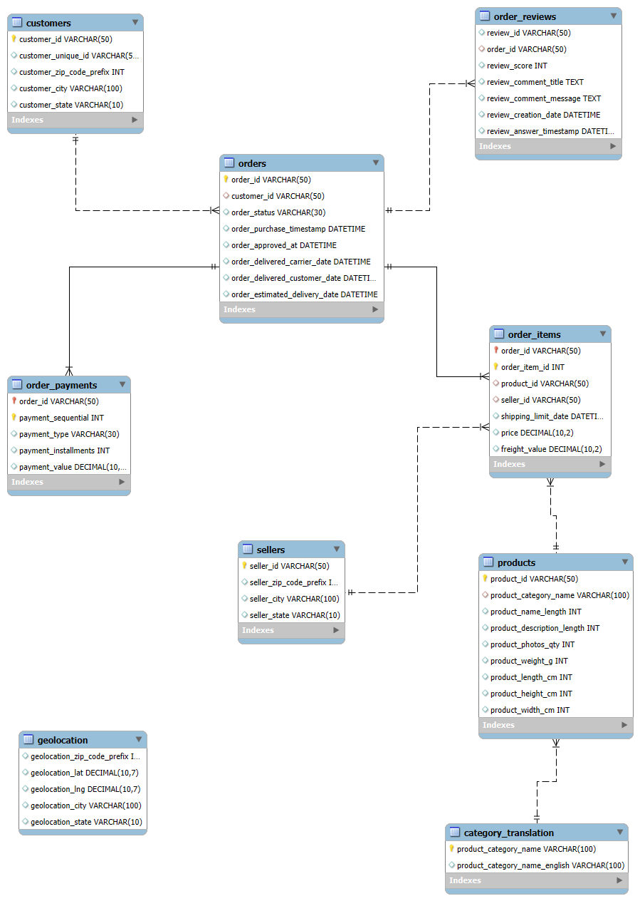
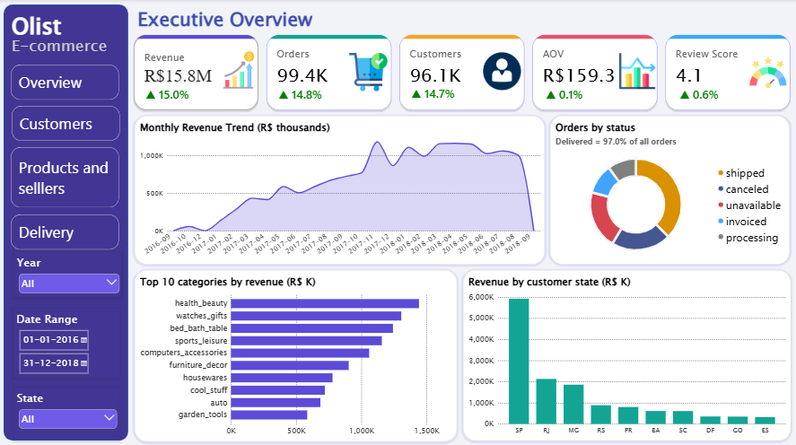
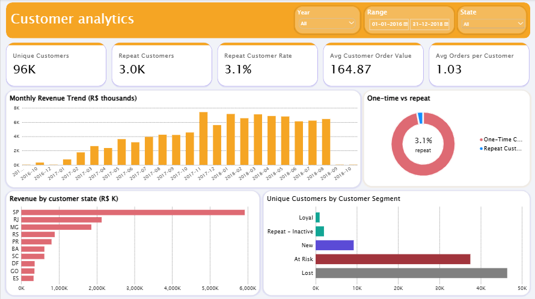

# 🛒 Olist E-Commerce SQL Analytics & Power BI Dashboard


An end-to-end analytics project on the **Olist Brazilian E-Commerce Public Dataset**, built with **MySQL** and **Power BI**. It covers the full analyst workflow: database design, data import, validation and cleaning, exploratory analysis, advanced analytics (cohorts, RFM, window functions), query optimization, business insights, and a four-page interactive dashboard.

---

## 📑 Table of Contents

- [Project Overview](#-project-overview)
- [Objectives](#-objectives)
- [Dataset](#-dataset)
- [Tech Stack](#️-tech-stack)
- [Project Structure](#-project-structure)
- [Database Schema](#️-database-schema)
- [Data Cleaning](#-data-cleaning)
- [SQL Analysis Modules](#-sql-analysis-modules)
- [Power BI Dashboard](#-power-bi-dashboard)
- [Business Questions Answered](#-business-questions-answered)
- [SQL Concepts Demonstrated](#-sql-concepts-demonstrated)
- [Getting Started](#-getting-started)
- [Key Insights](#-key-insights)
- [Future Improvements](#-future-improvements)
- [Author](#-author)

---

## 📌 Project Overview

Olist is a Brazilian marketplace that connects small businesses to customers across the country. This project analyzes its transactional data to understand:

- Sales and revenue performance
- Customer behavior and retention
- Product and category performance
- Seller performance
- Payment methods and installments
- Customer reviews and satisfaction
- Delivery operations

Beyond descriptive analysis, the project applies advanced SQL techniques including **CTEs, window functions, ranking, cohort analysis, RFM segmentation**, and **index-based query optimization** using `EXPLAIN`. The results are presented in an interactive **Power BI dashboard** with four report pages.

---

## 🎯 Objectives

- Analyze overall sales and revenue performance
- Identify top-performing products, categories, and sellers
- Understand customer purchasing behavior
- Identify repeat and high-value customers
- Analyze payment methods and installment usage
- Measure customer satisfaction through review scores
- Evaluate delivery performance and late deliveries
- Perform customer cohort and RFM segmentation
- Optimize query performance with indexes and execution plans
- Validate and clean the data before analysis
- Build an interactive Power BI dashboard for business users

---

## 🗂️ Dataset

**Source:** [Olist Brazilian E-Commerce Public Dataset (Kaggle)](https://www.kaggle.com/datasets/olistbr/brazilian-ecommerce)

The dataset contains roughly 100K orders placed between 2016 and 2018 and is split across nine related tables:

| Table | Description |
|---|---|
| `customers` | Customer identifiers and location |
| `orders` | Order status and purchase/delivery timestamps |
| `order_items` | Products purchased in each order, with price and freight |
| `order_payments` | Payment type, installments, and value |
| `order_reviews` | Customer review scores and comments |
| `products` | Product attributes and category |
| `sellers` | Seller information and location |
| `geolocation` | ZIP code latitude/longitude data |
| `category_translation` | Portuguese → English category names |

> **Note:** The raw CSV files are not included in this repository (see [Getting Started](#-getting-started)).

---

## 🛠️ Tech Stack

| Category | Tools |
|---|---|
| Database | MySQL 8.0 |
| Client | MySQL Workbench |
| Language | SQL, Python, DAX |
| Visualization | Power BI Desktop |
| Techniques | Joins, Subqueries, CTEs, Window Functions, Aggregations, Indexing, Query Optimization, Data Cleaning, Data Modeling |

---

## 📁 Project Structure

```text
olist-ecommerce-sql-analytics/
│
├── dashboard/
│   ├── olist_dashboard.pbix              # Power BI report file
│   └── screenshots/
│       ├── Executive_Overview.png
│       ├── Customer_Analytics.png
│       ├── Product_&_Seller_Analytics.png
│       └── Delivery_&_Satisfaction.png
│
├── data/                                 # CSV files (not tracked in Git)
│   ├── olist_*_dataset.csv               # Raw files from Kaggle
│   ├── olist_orders_clean.csv            # Output of scripts/clean_orders.py
│   └── olist_order_reviews_clean.csv     # Output of scripts/clean_reviews.py
│
├── docs/
│   ├── Olist_Ecommerce_Dataset_Overview.pdf
│   └── olist-er-diagram.png
│
├── scripts/
│   ├── clean_orders.py                   # Pre-import cleaning for orders
│   └── clean_reviews.py                  # Pre-import cleaning for reviews
│
├── sql/
│   ├── 01_create_database.sql            # Create database
│   ├── 02_create_tables.sql              # Table definitions, keys, constraints
│   ├── 03_import_data.sql                # Load CSV data
│   │
│   ├── 04_cleaning/                      # Validation and cleaning (run in order)
│   │   ├── 04a_data_validation.sql       # Data quality checks + PASS/FAIL scoreboard
│   │   ├── 04b_clean_data_types.sql      # Backups, date types, text standardization
│   │   ├── 04c_clean_duplicates.sql      # Remove duplicate reviews and geolocation rows
│   │   ├── 04d_clean_nulls_and_fixes.sql # Nulls, invalid values, category translation
│   │   ├── 04e_data_quality_checks.sql   # Bad-record and orphan checks (read-only)
│   │   └── 04f_create_analysis_views.sql # Analysis-ready view + final validation
│   │
│   ├── 05_sales_analysis.sql             # Revenue and sales analysis
│   ├── 06_customer_analysis.sql          # Customer behavior analysis
│   ├── 07_product_analysis.sql           # Product and category analysis
│   ├── 08_seller_analysis.sql            # Seller performance analysis
│   ├── 09_advanced_analysis.sql          # Delivery, reviews, RFM, cohorts
│   ├── 10_query_optimization.sql         # Indexes and execution plans
│   ├── 11_business_insights.sql          # Business-focused summary queries
│   └── 12_add_foreign_keys.sql           # Foreign key definitions
│
├── LICENSE
└── README.md
```

---

## 🗄️ Database Schema

### Entity Relationships

```text
customers
    │
    └── orders
          │
          ├── order_items ── products ── category_translation
          │        │
          │        └── sellers
          │
          ├── order_payments
          │
          └── order_reviews
```

`geolocation` links to customers and sellers through ZIP code prefix, and `category_translation` maps product categories to English names.



---

## 🧹 Data Cleaning

Data quality is handled in two stages: light pre-processing in **Python** before import, and validation plus cleaning in **SQL** after import. The SQL scripts live in `sql/04_cleaning/` and should be run in order.

| Script | Purpose |
|---|---|
| `04a_data_validation.sql` | Row counts, duplicates, NULLs, invalid values, date logic, orphan records, and a PASS / FAIL / INFO scoreboard |
| `04b_clean_data_types.sql` | Creates backups, converts text date columns to `DATETIME`, trims and standardizes text |
| `04c_clean_duplicates.sql` | Keeps one review per order and one geolocation row per ZIP prefix |
| `04d_clean_nulls_and_fixes.sql` | Handles missing categories, invalid weights, `not_defined` payments, zero installments, and adds missing category translations |
| `04e_data_quality_checks.sql` | Read-only checks for bad prices, illogical dates, and orphan records |
| `04f_create_analysis_views.sql` | Creates `v_orders_clean` and prints final row counts |

**Key cleaning decisions**

- **Reviews:** only the latest review per order is kept, and empty comments become `NULL`.
- **Geolocation:** reduced to one row per ZIP prefix, using average coordinates.
- **Categories:** two categories missing from the translation table (`pc_gamer` and `portateis_cozinha_e_preparadores_de_alimentos`) are added, and missing categories become `unknown`.
- **Payments:** `not_defined` payment rows are removed, and installments of `0` are set to `1`.
- **Customers:** `customer_unique_id` is used to identify real customers, because `customer_id` is generated per order.
- **Date range:** 2016 and late 2018 are incomplete, so the analysis view limits orders to **Jan 2017 – Aug 2018**.

> **Run `04c_clean_duplicates.sql` only once.** It renames `order_reviews` and `geolocation` to `*_raw` and replaces them with cleaned tables. Backups (`*_raw`, `*_backup`) are kept so the changes can be reversed.

---

## 🔎 SQL Analysis Modules

### 1. Data Validation and Cleaning — `sql/04_cleaning/`
- Row count validation across all tables
- Duplicate detection and removal
- NULL value checks and handling
- Invalid value and date validation
- Referential integrity and orphan record checks
- Analysis-ready view for reporting

### 2. Sales Analysis — `05_sales_analysis.sql`
- Total revenue, yearly and monthly sales trends
- Average Order Value (AOV)
- Category revenue, top products, and top sellers
- State-level sales
- Payment analysis
- Month-over-month growth
- Revenue contribution analysis

### 3. Customer Analysis — `06_customer_analysis.sql`
- Customer distribution and spending
- Repeat customers and purchase frequency
- Customer lifetime period
- Monthly active customers
- Customer ranking and spending segments
- RFM analysis and customer cohorts

### 4. Product Analysis — `07_product_analysis.sql`
- Product catalog and category performance
- Product revenue and units sold
- Pricing and freight analysis
- Product characteristics
- Sales ranking and unsold products

### 5. Seller Analysis — `08_seller_analysis.sql`
- Seller revenue and order volume
- Seller AOV and ranking
- Freight analysis and product diversity
- Performance segmentation and sales distribution

### 6. Advanced Analysis — `09_advanced_analysis.sql`
- Delivery performance and late delivery analysis
- Review score analysis and revenue vs. review score
- Category and seller satisfaction
- RFM segmentation and customer cohorts
- Top category by state
- Revenue concentration

### 7. Query Optimization — `10_query_optimization.sql`
- Single-column and composite index creation
- `EXPLAIN` and execution plan analysis
- Table size analysis
- Index verification

### 8. Business Insights — `11_business_insights.sql`
Business-focused queries covering top revenue categories, high-value customers, repeat customer rate, high-performing states, seller performance, customer satisfaction, late delivery rates, payment behavior, and revenue concentration.

---

## 🎨 Power BI Dashboard

The dashboard connects directly to the MySQL database and presents the analysis in four report pages. The report file is at [`dashboard/olist_dashboard.pbix`](dashboard/olist_dashboard.pbix).

| Page | Purpose |
|---|---|
| **1. Executive Overview** | Overall business performance |
| **2. Customer Analytics** | Customer behavior, repeat purchases, and segmentation |
| **3. Product & Seller Analytics** | Category, product, and seller performance |
| **4. Delivery & Satisfaction** | Delivery performance and review analysis |

### 1. Executive Overview

KPI cards for revenue, orders, customers, average order value, and review score, with the monthly revenue trend, revenue by customer state, top 10 categories, and orders by status. Year, date range, and state slicers filter the whole page.



### 2. Customer Analytics

Total and repeat customers, repeat customer rate, average revenue and orders per customer, new vs. repeat customers, top customers by revenue, revenue by state, and monthly new customers.



### 3. Product & Seller Analytics

Top categories and sellers by revenue, seller distribution by state, and a cumulative revenue chart by seller rank that shows how concentrated revenue is among top sellers.


### 4. Delivery & Satisfaction

Average delivery time, late delivery rate, review score distribution, and average review score for on-time vs. late orders.


### Data model and DAX highlights

- A dedicated **date table** is related to the order purchase date and drives all time-based visuals.
- **Unique customers** are counted with `customer_unique_id`, not `customer_id`.
- **Calculated columns** classify customers (`Customer Type`, `Customer Segment`) and orders (`Delivery Status`).
- **Measures** cover revenue, orders, AOV, review score, repeat rate, late delivery %, and cumulative revenue % by seller rank.
- Category names are shown in **English** using the `category_translation` table.

---

## ❓ Business Questions Answered

- How much total revenue was generated, and how has it trended over time?
- Which product categories generate the most revenue?
- Which products sell the most units?
- Which sellers generate the highest sales?
- Which states contribute most to revenue?
- What share of customers make repeat purchases?
- Which customers have the highest lifetime spending?
- How concentrated is revenue among high-value customers and top sellers?
- Which payment methods and installment plans are most common?
- How does delivery performance vary, and how often are orders late?
- How are review scores distributed, and how do they relate to delivery and revenue?
- Which products in the catalog have never been sold?

---

## 🧠 SQL Concepts Demonstrated

| Area | Concepts |
|---|---|
| Querying | `SELECT`, `WHERE`, `GROUP BY`, `HAVING`, `ORDER BY`, `LIMIT` |
| Joins | `INNER JOIN`, `LEFT JOIN` |
| Conditional logic | `CASE`, `COALESCE`, `NULLIF` |
| Aggregation | `COUNT`, `SUM`, `AVG`, `MIN`, `MAX` |
| Advanced SQL | Subqueries, CTEs |
| Window functions | `ROW_NUMBER()`, `RANK()`, `DENSE_RANK()`, `NTILE()`, `LAG()` |
| Date functions | `DATE_FORMAT()`, `DATEDIFF()`, `TIMESTAMPDIFF()` |
| Data cleaning | Deduplication with window functions, backups, type conversion, stored procedures, `information_schema` |
| Views | `CREATE VIEW` for analysis-ready data |
| Performance | `CREATE INDEX`, `EXPLAIN` |

---

## 🚀 Getting Started

### Prerequisites

- MySQL 8.0 or later (window functions and CTEs require 8.0+)
- MySQL Workbench (or any MySQL client)
- Power BI Desktop (to open the dashboard)
- MySQL Connector/NET (required by Power BI to connect to MySQL)

### Setup

**1. Clone the repository**

```bash
git clone https://github.com/Sharif-Abusad/olist-ecommerce-sql-analytics.git
cd olist-ecommerce-sql-analytics
```

**2. Download the dataset**

Download the CSV files from [Kaggle](https://www.kaggle.com/datasets/olistbr/brazilian-ecommerce) and place them in the `data/` folder.

**3. Run the SQL scripts in order**

```text
sql/01_create_database.sql
sql/02_create_tables.sql
sql/03_import_data.sql

sql/04_cleaning/04a_data_validation.sql
sql/04_cleaning/04b_clean_data_types.sql
sql/04_cleaning/04c_clean_duplicates.sql
sql/04_cleaning/04d_clean_nulls_and_fixes.sql
sql/04_cleaning/04e_data_quality_checks.sql
sql/04_cleaning/04f_create_analysis_views.sql

sql/05_sales_analysis.sql
sql/06_customer_analysis.sql
sql/07_product_analysis.sql
sql/08_seller_analysis.sql
sql/09_advanced_analysis.sql
sql/10_query_optimization.sql
sql/11_business_insights.sql
sql/12_add_foreign_keys.sql
```

> If `03_import_data.sql` fails with a `secure_file_priv` error, either move the CSV files to the directory shown by `SHOW VARIABLES LIKE 'secure_file_priv';` or use the Workbench **Table Data Import Wizard**.

> Run `04a_data_validation.sql` once before cleaning to see the issues, and again after `04f` to confirm every check passes.

**4. Verify the setup**

```sql
USE olist_ecommerce;
SHOW TABLES;
```

**5. Open the dashboard**

1. Open `dashboard/olist_dashboard.pbix` in Power BI Desktop.
2. Go to **Home → Transform data → Data source settings**, select the MySQL source, and click **Edit permissions**.
3. Set the server to `localhost` and the database to `olist_ecommerce`, choose the **Database** credentials tab (not Windows), and enter your MySQL username and password.
4. Click **Refresh** to load the data.

---

## 📊 Key Insights

| Area | Finding |
|---|---|
| Revenue | About **R$ 15.84M** in total revenue from **99.4K orders**, with an average order value of **R$ 159.3** |
| Customers | **96.1K** unique customers, and only **3.1%** are repeat buyers (average of 1.03 orders per customer) |
| Categories | **Health & beauty**, **watches & gifts**, and **bed, bath & table** lead revenue |
| Geography | **São Paulo (SP)** is by far the top state by revenue, followed by RJ and MG |
| Orders | **97%** of orders are delivered; canceled and unavailable orders are the main problem statuses |
| Satisfaction | Average review score is **4.1**, with **57.8%** of reviews rated 5 stars |

---

## 📈 Future Improvements

- Publish the dashboard to **Power BI Service** with scheduled refresh
- Automate cleaning and validation in a **Python** pipeline
- Add further query-performance benchmarks
- Add a forecasting page for revenue and order volume
- Add row-level security by seller or region

---

## 👤 Author

<div align="center">

**Sharif Abusad**

[](https://github.com/Sharif-Abusad)
[](https://linkedin.com/in/sharif-abusad)

*If you found this project useful, consider giving it a ⭐ on GitHub — it helps a lot!*

</div>

---

<div align="center">
<sub>Built with ❤️ using SQL, MySQL, Power BI, and Python</sub>
</div>